# LinX · AI 中转站管理与用量看板

把中转站价格、余额、验纯记录和真实用量放进同一个工作台。支持本机运行，也支持在自己的服务器部署，通过同一账号跨电脑使用。

[下载当前部署包 · 2026.11.12](https://github.com/LinX-Wang/gpt-relay-price-monitor/archive/refs/tags/server-2026.11.12.zip) · [本次更新](CHANGELOG.md) · [用量功能说明](docs/USAGE.md)

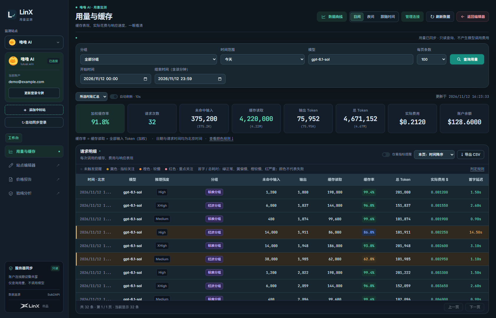

> 所有截图均来自独立演示环境。用量页展示“噜噜 AI”和“万家灯火”的真实站名、公开域名与图标，其余站名及邮箱、余额、倍率、匹配度和用量均为虚构示例；不包含作者账户、令牌或真实检测记录，不构成中转站推荐。

[部署与迁移](docs/DEPLOYMENT.md) · [两个检测工具](docs/DETECTORS.md) · [字体与出品标识](docs/DESIGN.md)

[浏览器自动同步登录](docs/BROWSER_SYNC.md)：为已连接的中转站安装一次浏览器扩展，官网保持登录即可自动同步新令牌，减少手动更新操作。

## 功能

| 模块 | 功能 |
| --- | --- |
| 站点编辑器 | 价格倍率、余额、赠送和手动签到；搜索、筛选、排序；保存后同步报告与验纯页 |
| 价格报告 | 汇总对比、使用结论、报销标签、HTML / CSV 导出和成本计算器 |
| 验纯分析 | 按站点、模型、倍率分组记录；推荐 / 一般 / 避雷；报销说明和历史趋势图 |
| 分组调价 | 稳定分组标识追踪调价、合并，保留检测时的历史倍率 |
| 用量监测 | 多站点、自动图标、Token、费用、首字延迟、耗时、推理强度和加权缓存率 |
| 用量数据中心 | 独立弹窗展示趋势曲线、月度用量日历与自动日报；按模型、分组筛选，与前日比较 |
| 自动更新 | 每 10 秒查询；后台尝试刷新、返回补刷；跨天更新日期，更新令牌后立即读取 |
| 连接管理 | 默认站点官网登录令牌，服务器加密保存；从编辑器搜索添加站点；折叠式教程 |
| 浏览器同步 | Chrome / Edge 扩展自动同步已授权站点的新登录令牌；账户一致性检查与设备撤销 |
| 统一外观 | 日间 / 夜间 / 跟随时间跨页面同步；中文、英文与数字字体分别配置 |
| 共享部署 | 管理员登录、账号设置、服务器持久化、备份和可选自托管检测工具 |

用量适配 **Sub2API 风格接口**，不保证兼容所有中转面板。监测只读取账户和用量，不发起模型生成；检测工具则会调用模型并产生相应费用。

## 页面预览

### 编辑器：日间与夜间

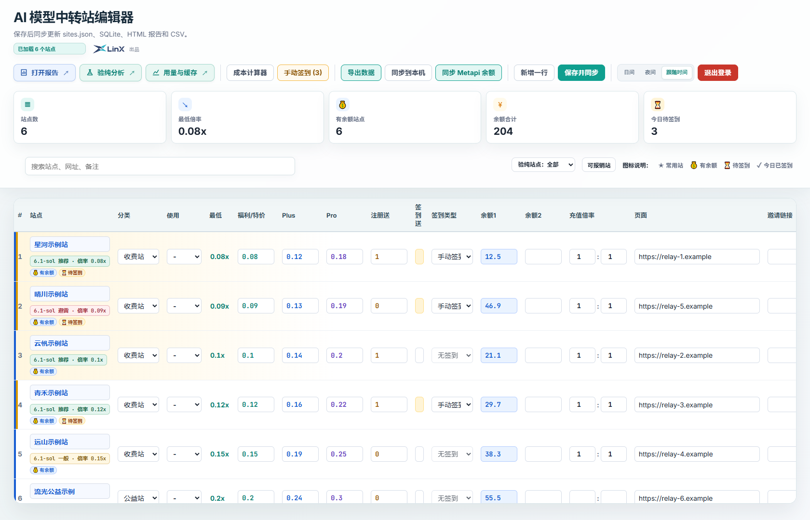

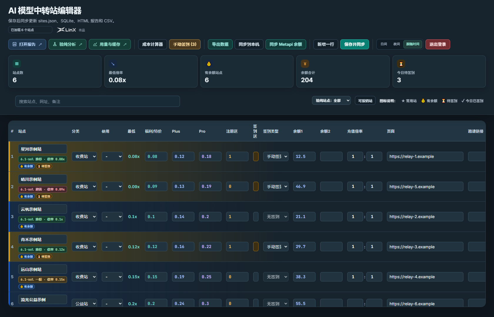

### 价格报告

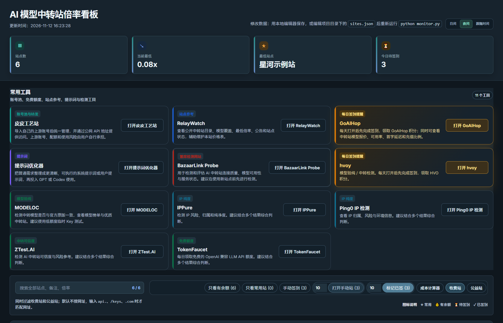

### 验纯分析与历史趋势

匹配度大于 95% 默认推荐，0% 默认避雷，其余默认一般，均可手动调整。检测证据和使用结论分别保留；按模型、倍率分组查看对应历史，避免混淆不同分组。

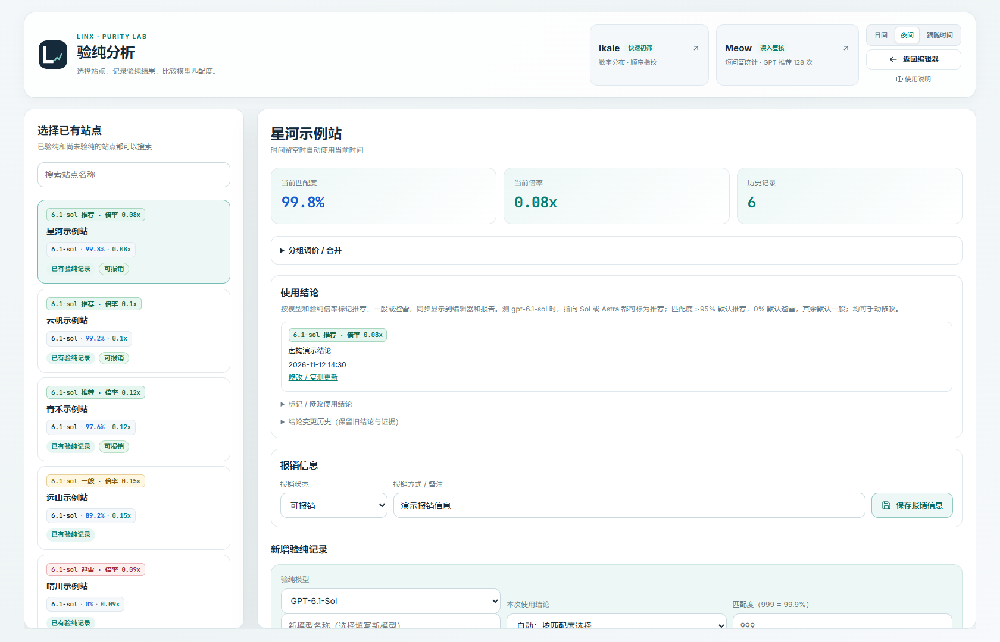

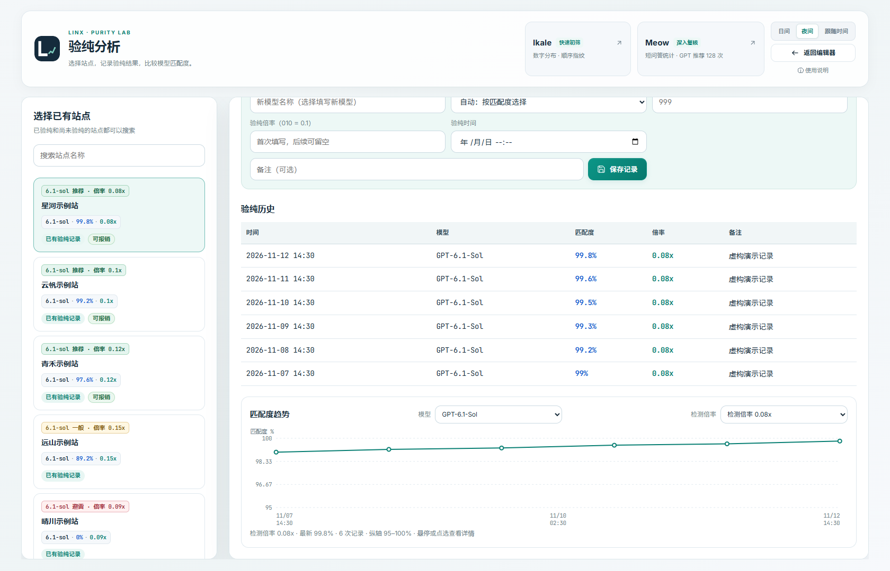

### 带图标的站点切换

切回看过的站点时先显示上次记录，再获取最新数据。颜色表示缓存率、费用与耗时提醒，不代表请求失败。

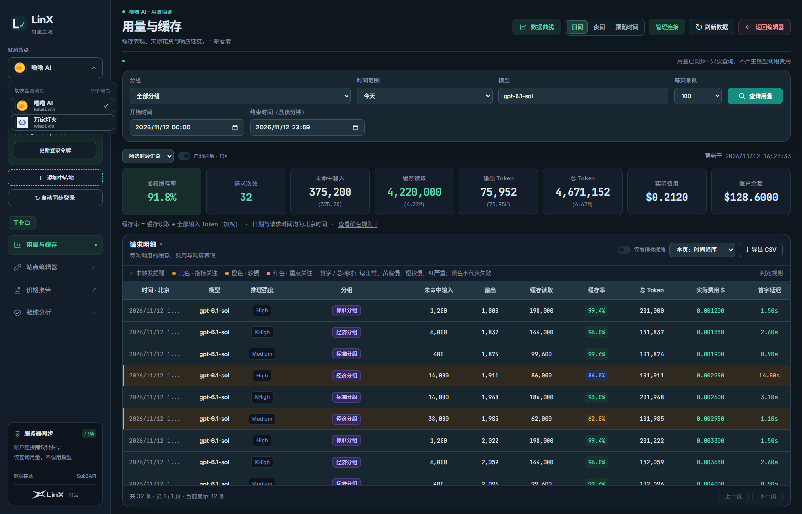

### 用量数据中心：曲线、日历与日报

在用量页点击“数据曲线”，切换到用量日历或自动日报。日历按 Token、请求数或费用显示深浅，提供本月汇总；日报按当前站点、模型和分组自动生成，展示缓存进度与近 7 日节奏。完整日期与前一天比较，今天标记为进行中；缺失数据保留为空。

三个视图共享后台预取的逐天统计，同月切换日期无需重新读取。前后端均合并相同的并发请求，服务器可用已有较大范围的缓存响应较短范围查询；统计缓存为 60 秒。首次读取尚未缓存的日期范围仍取决于上游响应速度。日报为站内展示，不发送外部通知，数据取自兼容的中转站日聚合接口。

站点标签同时显示中转站图标、站名、模型与分组范围；切换站点后同步变化。数字沿用统一的数字字体，日夜主题一致。

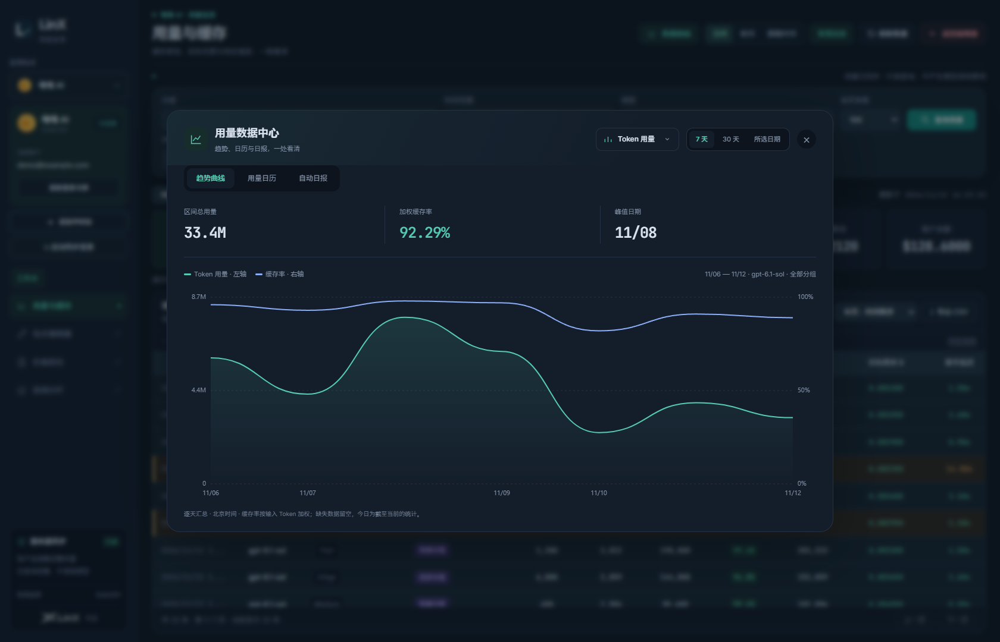

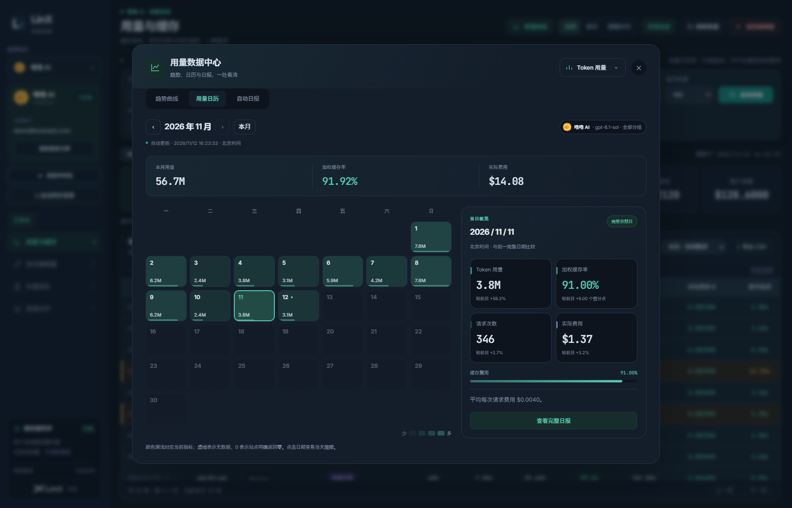

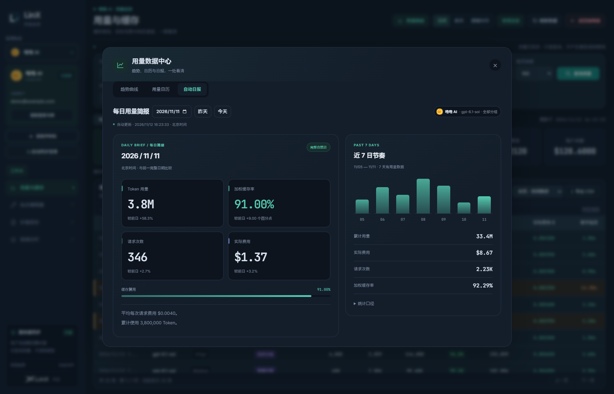

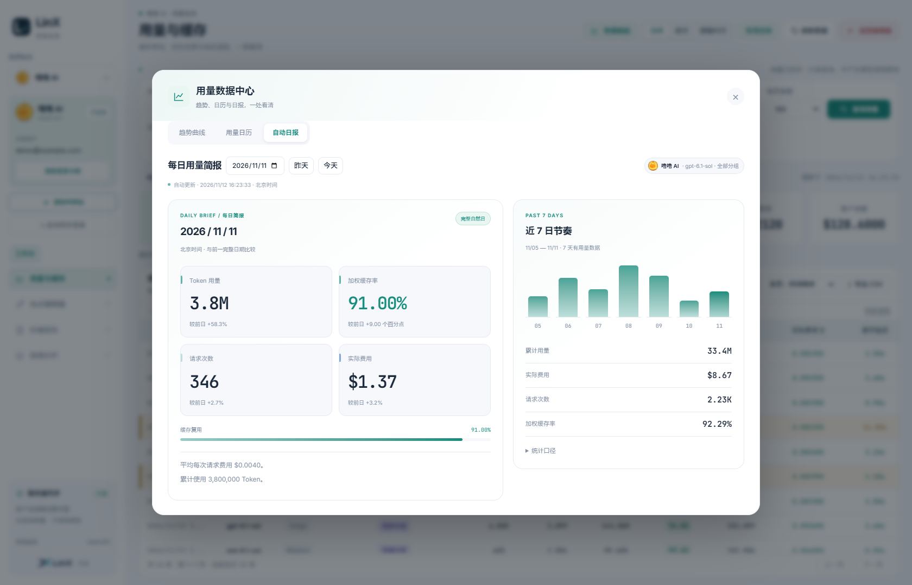

### 登录与成本估算

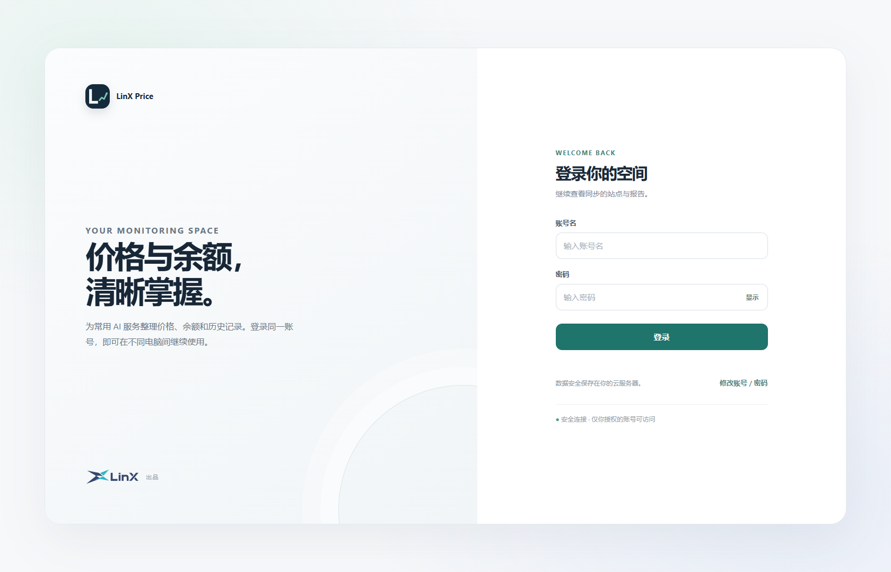

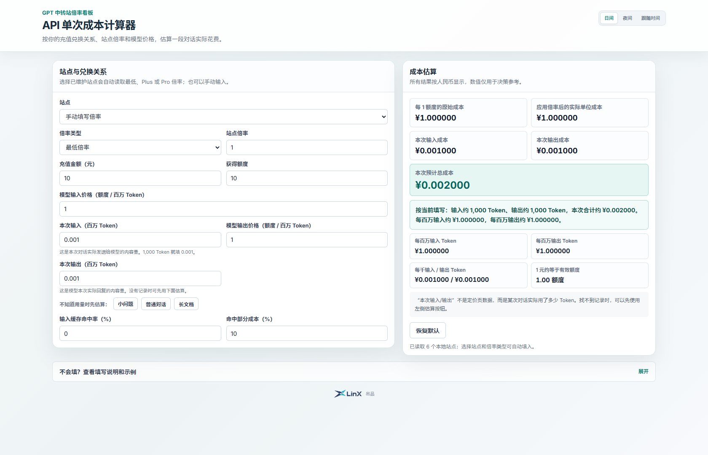

## 快速启动

需要 **Python 3.10+**，主程序没有前端构建步骤。

可直接下载上方部署包并解压，在项目目录执行以下命令中的虚拟环境、依赖安装与启动步骤。习惯 Git 的用户也可以克隆：

~~~bash
git clone https://github.com/LinX-Wang/gpt-relay-price-monitor.git
cd gpt-relay-price-monitor
python -m venv .venv
~~~

Windows：

~~~powershell
.\.venv\Scripts\python.exe -m pip install -r requirements.txt
.\.venv\Scripts\python.exe app.py
~~~

Linux / macOS：

~~~bash
.venv/bin/pip install -r requirements.txt
.venv/bin/python app.py
~~~

打开 **http://127.0.0.1:8765/**。首次启动为干净空白实例。已有数据按 [迁移说明](docs/DEPLOYMENT.md#数据和迁移) 恢复。

可选使用已安装依赖的 Python 运行 python scripts/seed_demo.py，创建虚构示例。脚本拒绝覆盖已有站点或数据库；应用已启动过时，先指定另一个空的 APP_DATA_DIR。

## 服务器部署

先运行 python scripts/configure.py，交互配置自己的域名、管理员账号及密码，再选择：

- **systemd + Caddy**：模板在 deploy/，主程序经反向代理提供 HTTPS。
- **Docker Compose**：配置完成后运行 docker compose up -d --build，数据保存在命名卷。

完整步骤、环境变量与备份见 [部署文档](docs/DEPLOYMENT.md)。本机默认没有登录限制，共享部署须配置认证。本项目是共享管理工作台，不是多租户服务。

## 两个验纯工具

- **Ikale**：数字分布、顺序指纹，快速初筛。
- **Meow**：短问答统计，深入复核。

主程序独立负责记录和展示；两个检测服务需要另外安装，见 [检测集成](docs/DETECTORS.md)。主程序 Docker 镜像不包含它们的独立运行时。

Meow 额外展示规则：声明 GPT-6.1-Sol 时，证据充分且强指向 Sol 或 Astra 都显示为好结果；不修改原始分数和判定线，证据不足仍待确认。统计检测提供证据，不能绝对证明实际模型来源。

## 数据与隐私

- 站点、验纯记录、报销说明和加密连接保存在部署者自己的服务器。
- 加密连接与密钥需要一起备份；令牌过期后可在对应站点更新。
- .env、sites.json、SQLite、报告、连接、备份与检测运行目录均不提交 Git。
- 仓库只含空白配置与可选的虚构演示种子，旧静态站点清单和旧导出 CSV 已移除。
- 浏览器休眠或冻结后台标签页时，定时器可能暂停；返回页面后补刷。

## 开发与验证

~~~bash
python -m pip install -r requirements-dev.txt
python -m unittest discover -s tests -v
python scripts/screenshots.py
python scripts/check_browser_sync_browser.py
~~~

截图脚本自动创建临时数据、临时账号与本地服务，重新生成 README 中的 13 张截图，覆盖编辑器、报告、验纯、用量、趋势、日历及日夜日报。用量接口使用虚构响应，不连接真实中转站。Windows 默认使用已安装的 Chrome；也可用 --chrome 指定路径，其他环境可安装 Playwright Chromium（python -m playwright install chromium）。浏览器检查脚本还验证跨视图请求复用、筛选隔离、同步连接恢复及手机边界。

## 项目结构

~~~text
app.py / monitor.py          编辑器服务、数据与报告
purity*.py / purity*.js      验纯结论、稳定分组与界面
usage_*.py / cache.html      多站点用量与缓存看板
usage-trends.js              趋势、日历、自动日报及共享读取
settings.py                 环境配置与持久化路径
assets/                     产品图标、出品标识、字体许可
deploy/                     systemd / Caddy 模板
integrations/               可选检测服务安装器、托管适配
scripts/                    配置、备份、演示与截图工具
docs/                       部署、设计、集成说明与截图
~~~

## 许可与署名

主程序沿用 [MIT](LICENSE)。第三方字体、检测工具及其派生 UI 保留各自许可，详见 [第三方声明](THIRD_PARTY_NOTICES.md)；Meow v4.5.4 使用 PolyForm Noncommercial License 1.0.0，不能由主程序 MIT 替代。

**LinX 出品**是出品方署名，与各款软件自己的图标、favicon 和名称分别使用。
